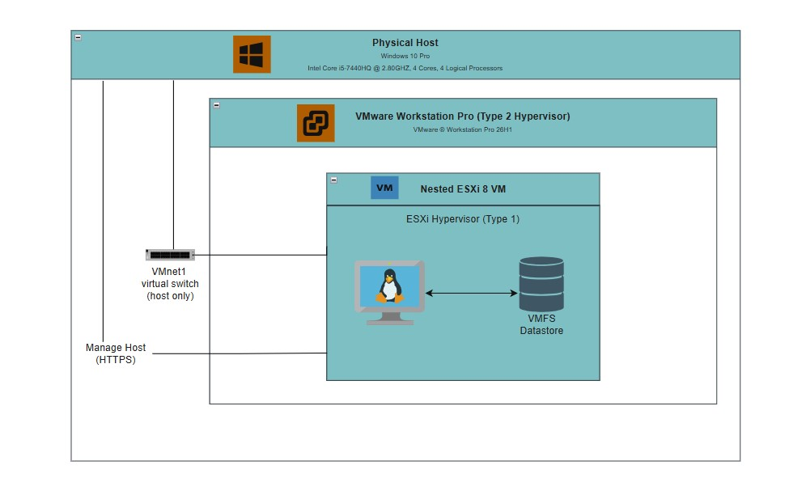
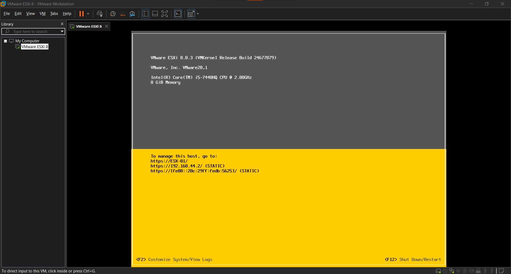
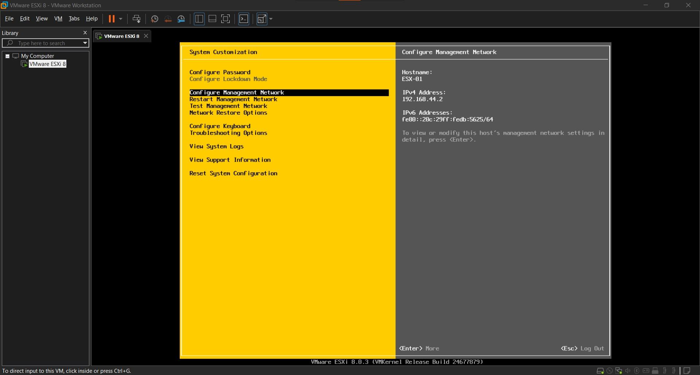
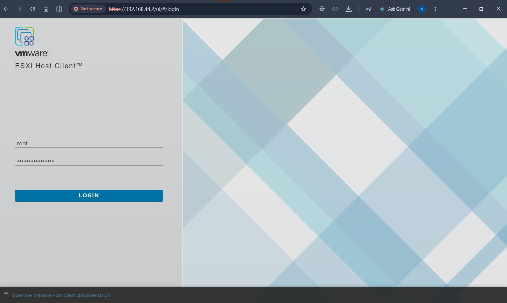
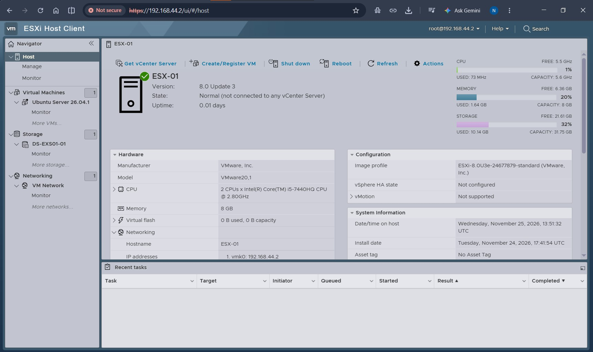
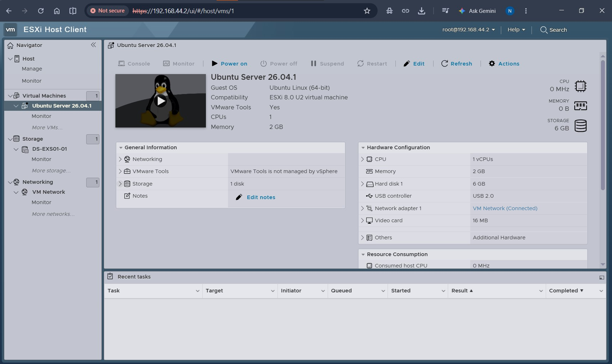
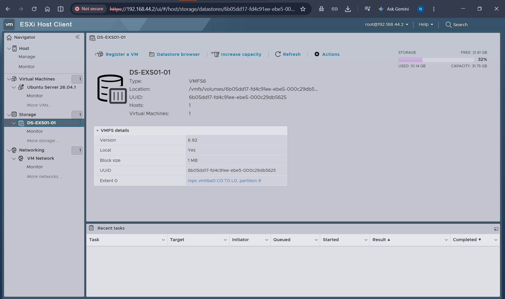
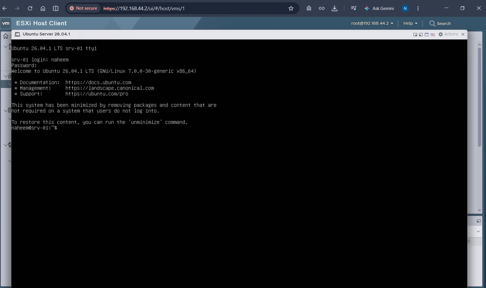
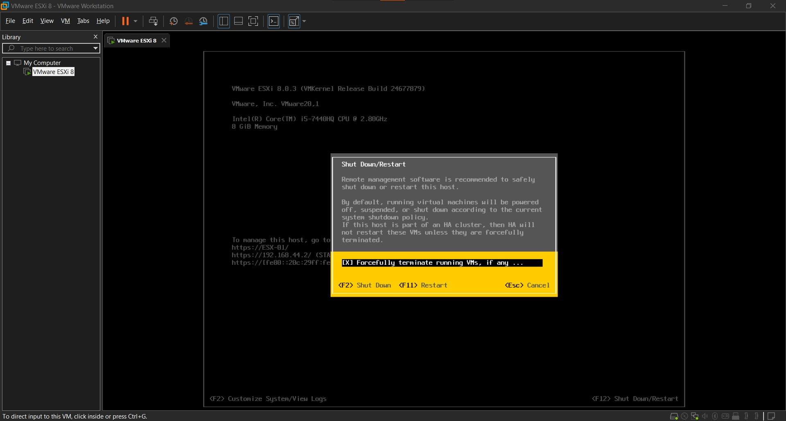

# Deployment and Administration of a nested VMware ESXi 8 Virtualization Environment using VMware Workstation Pro


## Table of Contents

- [1. Overview](#1-overview)
- [2. Objectives](#2-objectives)
- [3. Architecture](#3-architecture)
- [4. Proof of Execution](#4-proof-of-execution)
- [5. Troubleshooting](#5-troubleshooting)
- [6. Limitations](#6-limitations)
- [7. Future Improvements](#7-future-improvements)
- [8. Author](#8-author)


## 1. Overview
This project documents the deployment and administration of a VMware ESXi virtualization environment running as a nested hypervisor inside a VMware Workstation VM.
Configured ESXi and browser-based management, provisioned a VMFS datastore, and deployed an Ubuntu Server 26.04.1 virtual machine on top of it.

The lab was done this way due to a lack of a dedicate bare-metal machine on which ESXi could run. 
The environment runs on a Windows host with limited hardware resources, making it a small-scale lab for learning and testing virtualization concepts.

## 2. Objectives
Enterprise environments run VMware vSphere platform on dedicated server hardware, which is not available to most students. The goal of this lab was to build a working ESXi environment on a single laptop using nested virtualization, in order to:

- Understand the basics of the VMware vSphere platform and its features, including: vCenter Server, live VM migration (vMotion), high availability (HA), distributed resource scheduling (DRS), etc.; 
- Understand how EXSi is installed, configured and administered;
- Gain hands-on experience on performing core ESXi administration tasks are run: networking, storage, and VM deployment;

## 3. Architecture
```
Physical PC: Windows 10 Pro, Intel Core i5-7440HQ
 └─ VMware Workstation (Type 2 hypervisor)
     └─ ESXi VM (running ESXi 8 - Type 1 hypervisor, nested)
         ├─ Virtual networking: vSwitch
         ├─ VMFS datastore
         └─ Ubuntu Server 26.04.1 VM
```

## 4. Proof of Execution

<p align="center">
  <em>ESXi Direct Console User Interface (DCUI)</em>
</p>
<br>
<br>


<p align="center">
  <em>Simple Static Configurations</em>
</p>
<br>
<br>


<p align="center">
  <em>ESXi Host Web Login</em>
</p>
<br>
<br>


<p align="center">
  <em>ESXi Host Management Interface</em>
</p>
<br>
<br>


<p align="center">
  <em>Virtual Machines</em>
</p>
<br>
<br>


<p align="center">
  <em>VMFS Datastore</em>
</p>
<br>
<br>


<p align="center">
  <em>Ubuntu Server Running as a Guest Virtual Machine</em>
</p>
<br>
<br>


<p align="center">
  <em>ESXi Shutdown</em>
</p>


## 5. Troubleshooting
#### 1. ESXi Management Network

The ESXi host initially experienced DHCP connectivity issues. I reviewed the virtual network adapter configuration in VMware Workstation and adjusted the network settings to provide management connectivity.

#### 2. Datastore Configuration
After installation, the expected datastore was not immediately available. The ESXi virtual disk was initially configured with 32 GB of capacity.
The virtual disk was expanded to 64 GB, after which the additional storage became available for datastore configuration.
I formatted the additional 32 GB of available space as a VMFS datastore.
VMFS (Virtual Machine File System) is VMware's file system used to store virtual machine files, including virtual disks and configuration files.

#### 3. Nested Virtualization

The Ubuntu Server VM initially encountered a virtualization compatibility issue related to a conflict with the, also running on the machine, Hyper-V hypervisor. I reviewed the nested virtualization settings and resolved the configuration issue, allowing Ubuntu Server to run inside ESXi.

## 6. Limitations
The current lab is designed for learning and demonstration purposes. The environment has the following limitations:
- The lab currently uses standalone ESXi management, due to lack of resources to practice the full vSphere platform.
- ESXi runs on top of a VM rather than directly on physical hardware.
- The physical host is a regular laptop and has limited memory and storage resources.
- vCenter Server has not been deployed.

These limitations are documented to distinguish the current implementation from a production virtualization environment.

## 7. Future Improvements
Possible extensions to the lab include:
- Deploying vCenter Server when sufficient hardware resources are available.
- Adding more ESXi hosts and practice other features such as vMotion, etc.
- Explore virtual networking.
- Exploring shared storage concepts.
- Implementing monitoring and resource utilization tracking.
- Explore backup and recovery procedures. 

## 8. Author
This lab was built as part of my practical learning in ***Network, Infrastructure, Systems and Security Administration***. <br><br>
**Naheem Abasse**
- Phone: [+258 86 720 5050](tel:+258867205050)
- Email: [naheem.abasse87@gmail.com](mailto:naheem.abasse87@gmail.com)
- GitHub: [@naheemabasse](https://github.com/naheemabasse)
